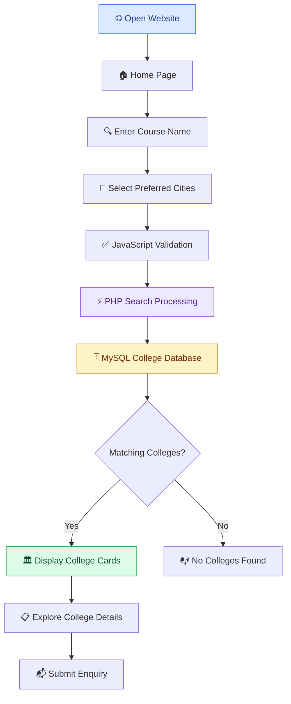
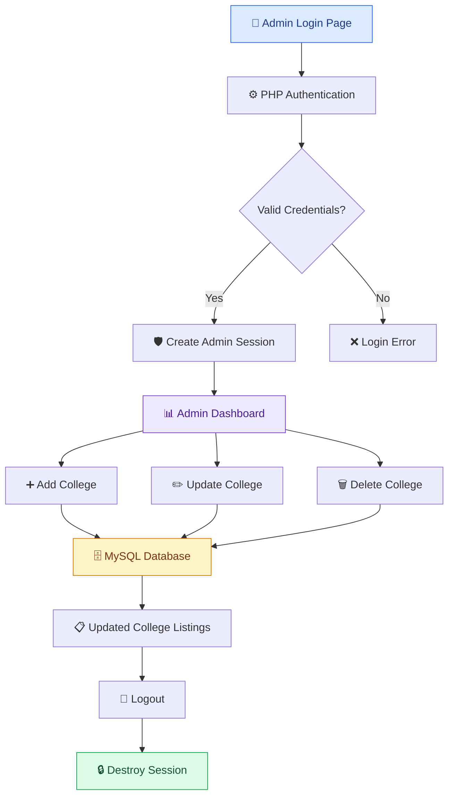
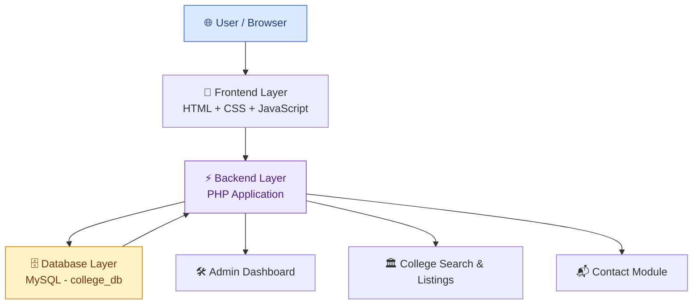

# 🎓 Search-For-College
### College Search & Discovery Portal

<p align="center">
  <b>Discover. Compare. Explore. Find the right college for your future.</b>
</p>

<p align="center">
  
  
  
  
  
  
</p>

---

## 🌟 Overview

**Search-For-College** is a dynamic, database-driven college discovery platform designed to simplify the college search process for students and parents.

Finding the right college often involves visiting multiple websites, comparing different courses, checking fee structures, and researching facilities. Search-For-College brings this information together in one centralized platform.

Users can explore colleges based on their preferred courses and cities, browse categorized listings, and access important college information through an intuitive interface.

The platform also includes an administrative dashboard that allows authorized administrators to manage college listings efficiently.

### 🎯 Project Objectives

- Simplify the college discovery process.
- Provide course-based and city-based college searches.
- Present college information in an organized format.
- Help students explore affordable and highly ranked institutions.
- Provide centralized management of college listings.
- Create a simple and responsive user experience.

## ✨ Key Features

<details>
<summary><b>🔍 1. Smart College Search</b></summary>

- Search colleges using course names such as BCA, BBA, MBA, and BTech.
- Select multiple preferred cities.
- Filter results according to the submitted search criteria.
- Display matching college listings dynamically.
- Show an appropriate message when no colleges match.

</details>

<details>
<summary><b>🏛️ 2. Detailed College Profiles</b></summary>

Each college listing can display:

- College name and image.
- Location and city.
- Course information.
- Fee structure.
- College ranking.
- Contact number.
- Official website.
- Available facilities.

</details>

<details>
<summary><b>🗂️ 3. College Categories</b></summary>

Explore colleges through dedicated categories:

- **All Colleges:** Browse all available listings.
- **Top 10:** Explore colleges with ranking values of 10 or below.
- **Affordable:** Find colleges with annual fees below ₹30,000.
- **Engineering:** Explore listings matching IIT, DTU, NSUT, or IIIT naming criteria.

</details>

<details>
<summary><b>🔐 4. Admin Authentication</b></summary>

- Dedicated administrator login page.
- PHP session-based authentication.
- Protected administrative dashboard.
- Logout functionality with session destruction.

</details>

<details>
<summary><b>⚙️ 5. College Management Dashboard</b></summary>

Administrators can:

- Add new college listings.
- Update existing college information.
- Delete college records.
- Manage the information displayed on the public platform.

</details>

<details>
<summary><b>📬 6. Contact & Enquiry Form</b></summary>

- Collect visitor names and email addresses.
- Accept enquiry subjects and messages.
- Perform required-field validation.
- Validate email formatting.
- Apply HTML output escaping using `htmlspecialchars()`.

</details>

<details>
<summary><b>🎨 7. Interactive User Interface</b></summary>

- Dark-themed card-based interface.
- Responsive college listing grid.
- Hover animations.
- Organized navigation.
- JavaScript-powered form validation.

</details>

## 🖥️ Platform Preview

The platform is organized into two primary interfaces:

| Student / Visitor Portal | Admin Dashboard |
|---|---|
| Search colleges | Manage college listings |
| Browse college categories | Add new colleges |
| Explore college profiles | Update college information |
| Submit enquiries | Delete college records |

## 🔄 How It Works — Application Workflow

### Student / Visitor Workflow



### Admin Workflow



## 🏗️ System Architecture

Search-For-College follows a traditional three-layer web application architecture.



### Architecture Components

| Layer | Technology | Responsibility |
|---|---|---|
| Presentation Layer | HTML5, CSS3, JavaScript | User interface, navigation, validation |
| Application Layer | PHP | Authentication, search, college management |
| Database Layer | MySQL | College records, users, administrators, contacts |
| Local Server | Apache / XAMPP | Application hosting and PHP execution |
| Database Management | phpMyAdmin | Database creation and administration |

### Core Application Modules

1. **Authentication Module:** Handles administrator login and session management.
2. **College Search Module:** Processes course and city-based search requests.
3. **College Listing Module:** Displays categorized college information.
4. **Admin Management Module:** Provides college creation, updating, and deletion.
5. **Contact Module:** Handles visitor enquiries.
6. **Presentation Module:** Manages website layout, navigation, and interactive elements.

## 📁 Project Structure

```text
Search-For-College/
│
├── index.html              # Homepage and college search
│
├── colleges.php            # College listings and category tabs
├── search.php              # Course and city-based search
├── contact.php             # Contact and enquiry form
│
├── login.html              # Admin login interface
├── login.php               # Admin authentication
├── dashboard.php           # Admin dashboard
├── logout.php              # Session termination
│
├── db.php                  # MySQL database connection
├── style.php               # Shared stylesheet rules
│
├── add-college.php         # Add college records
├── update-college.php      # Update college records
├── delete-college.php      # Delete college records
│
└── README.md               # Project documentation
```

## 🗄️ Database Design

The application uses **MySQL** as its relational database management system.

<badge color="info">Database: college_db</badge>

### Database Tables

| Table | Purpose |
|---|---|
| `users` | Stores registered user login information |
| `admins` | Stores administrator login information |
| `colleges` | Stores college details and listings |
| `contacts` | Stores contact and enquiry information |

### Important Database Attributes

| Attribute | Data Type | Description |
|---|---|---|
| `id` | INT | Unique record identifier |
| `username` | VARCHAR(50) | Login username |
| `password` | VARCHAR(50) | Authentication credential in the documented schema |
| `name` | VARCHAR(255) | College or contact name |
| `location` | VARCHAR(255) | College location |
| `course` | VARCHAR(255) | Course offered |
| `image` | VARCHAR(255) | College image filename |
| `email` | VARCHAR(100) | Contact email address |
| `message` | TEXT | Enquiry message |

### Database Relationships

- Each college record has a unique identifier.
- Administrator records are maintained separately from regular user records.
- Contact submissions are organized in a dedicated table.
- Primary keys identify individual records.
- Username uniqueness is part of the documented database design.

*Note: The actual SQL schema and field definitions should match the queries used in the PHP application.*

## 📄 Page & Endpoint Reference

| Page | Method | Access | Functionality |
|---|---|---|---|
| `index.html` | GET | Public | Homepage and search interface |
| `search.php` | GET | Public | Search colleges |
| `colleges.php` | GET | Public | Categorized college listings |
| `contact.php` | GET / POST | Public | Visitor enquiries |
| `login.html` | GET | Public | Admin login form |
| `login.php` | POST | Public | Admin authentication |
| `dashboard.php` | GET | Admin | College management |
| `logout.php` | GET | Admin | Logout and session destruction |

### Search Parameters

Example:

```text
search.php?course=BCA&city[]=Delhi
```

| Parameter | Description |
|---|---|
| `course` | Selected course name |
| `city[]` | One or more selected cities |

## 🚀 Installation & Local Setup

Follow these steps to run Search-For-College on your computer.

### Prerequisites

- PHP
- MySQL
- Apache Server
- XAMPP
- Modern web browser
- Visual Studio Code (recommended)

### Step 1: Clone the Repository

```bash
git clone https://github.com/<your-username>/Search-For-College.git
```

### Step 2: Move the Project

Copy the project folder into the XAMPP `htdocs` directory.

**Windows:**

```text
C:\xampp\htdocs\Search-For-College
```

**Linux:**

```text
/opt/lampp/htdocs/Search-For-College
```

### Step 3: Start XAMPP

1. Open XAMPP Control Panel.
2. Start Apache.
3. Start MySQL.

### Step 4: Create the Database

Open phpMyAdmin:

```text
http://localhost/phpmyadmin
```

Create a database named:

```sql
CREATE DATABASE college_db;
```

Create the required tables and fields according to the database design and the SQL queries used by the application.

### Step 5: Configure Database Connection

Open `db.php` and configure the connection:

```php
<?php

$host = "localhost";
$user = "root";
$password = "";
$database = "college_db";

$conn = mysqli_connect(
    $host,
    $user,
    $password,
    $database
);

if (!$conn) {
    die("Database connection failed: " . mysqli_connect_error());
}

?>
```

Use credentials appropriate for your local MySQL installation.

### Step 6: Launch the Application

Open your browser and visit:

**Student / Visitor Portal**

```text
http://localhost/Search-For-College/index.html
```

**College Listings**

```text
http://localhost/Search-For-College/colleges.php
```

**Admin Login**

```text
http://localhost/Search-For-College/login.html
```

<badge color="success">Local setup</badge> Your application should now be accessible through your local Apache server.

## 🧰 Technology Stack

| Category | Technologies |
|---|---|
| Frontend | HTML5, CSS3, JavaScript |
| Backend | PHP |
| Database | MySQL |
| Local Development | XAMPP |
| Web Server | Apache |
| Database Administration | phpMyAdmin |
| Development Environment | Visual Studio Code |
| Version Control | Git / GitHub |

## 👥 User Roles & Permissions

### 🧑‍🎓 Student / Visitor

- Access the homepage.
- Search colleges by course.
- Select preferred cities.
- Browse all college listings.
- Explore Top 10, Affordable, and Engineering categories.
- View college information.
- Submit enquiries through the contact form.

### 🛡️ Administrator

- Authenticate through the admin login page.
- Access the protected dashboard.
- Add college records.
- Update existing college information.
- Delete college records.
- Log out securely through session termination.

## 🔒 Security Considerations

The project includes basic security-related functionality, including PHP sessions, input validation, and HTML output escaping.

Before production deployment, the following improvements are recommended:

- Replace hardcoded admin credentials with database-backed authentication.
- Store passwords using PHP `password_hash()` and verify them using `password_verify()`.
- Use prepared SQL statements to prevent SQL injection.
- Implement server-side validation for every submitted form.
- Add CSRF protection to administrative actions.
- Restrict access to administrative PHP endpoints.
- Configure secure session cookies and regenerate session IDs after authentication.
- Use HTTPS for production hosting.
- Protect database credentials using environment variables.

**Important:** The current documented implementation is a local/demo application. Its hardcoded administrator credentials and limited server-side protections should be upgraded before public production use.

## ⚠️ Current Limitations

| Area | Current Limitation |
|---|---|
| Authentication | Single hardcoded admin account |
| User Management | No complete dynamic registration or role management |
| Validation | Basic client-side validation; server-side protection needs improvement |
| Search | Course and city matching relies on basic filtering |
| Database | MySQL-backed application with limited analytics |
| Contact Module | Database insertion and email functionality are not fully implemented |
| Interface | Data updates generally require page reloads |
| Reporting | No advanced analytics or downloadable reports |

## 🔭 Future Enhancements

The following features could transform Search-For-College into a more comprehensive college discovery platform.

- [ ] **AI-Powered College Recommendations:** Recommend colleges based on student preferences, courses, budget, and location.
- [ ] **Advanced Search Filters:** Add filters for fees, ranking, placements, ownership, and facilities.
- [ ] **College Comparison:** Compare multiple colleges side by side.
- [ ] **Student Registration:** Introduce individual student accounts and personalized profiles.
- [ ] **Role-Based Access Control:** Add Admin, Student, and College Representative roles.
- [ ] **Admission Tracking:** Display admission deadlines and application status.
- [ ] **Scholarship Finder:** Help students discover scholarship opportunities.
- [ ] **Placement Information:** Display placement statistics and company information.
- [ ] **Favorites & Shortlists:** Allow students to save preferred colleges.
- [ ] **Email Notifications:** Send admission alerts and enquiry confirmations.
- [ ] **Admin Analytics:** Display popular searches, city-wise trends, and college statistics.
- [ ] **Cloud Deployment:** Move the application to a production hosting environment.

## 💡 Why This Project?

Search-For-College demonstrates the practical application of full-stack web development concepts, including:

- Dynamic web application development.
- PHP server-side programming.
- Relational database management.
- CRUD operations.
- Session-based authentication.
- Search and filtering logic.
- Frontend form validation.
- Modular application development.

It provides a practical foundation for building larger education-focused platforms.

## 👨‍💻 Developer

<p align="center">
  <b>Lakshya Kansal</b>
  <br/>
  Full-Stack Development | Software Engineering
  <br/><br/>
  <a href="https://github.com/">
    GitHub
  </a>
</p>

---

<p align="center">
  ⭐ If you find this project useful, consider giving the repository a star!
  <br/><br/>
  <b>Search-For-College — Making College Discovery Simpler.</b>
</p>
